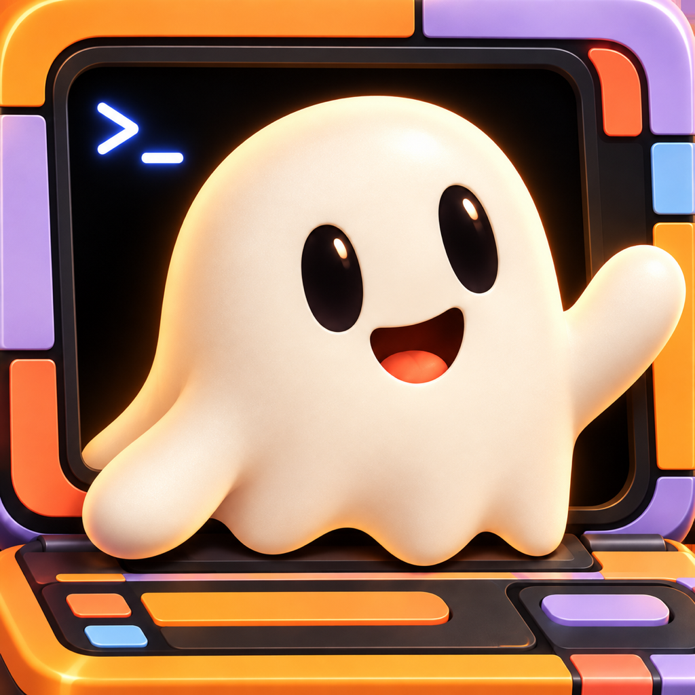
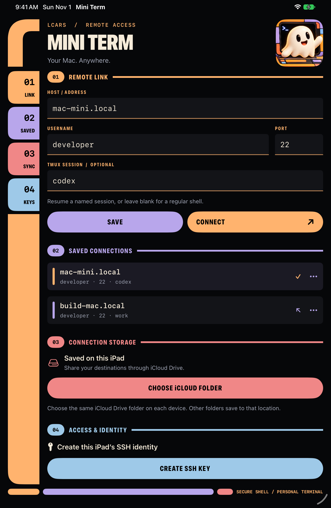
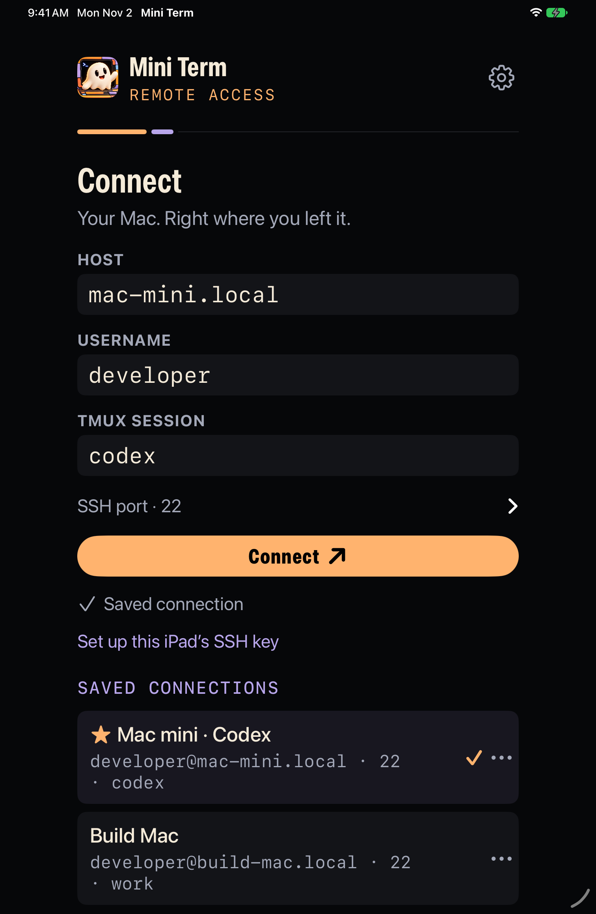

# Mini Term



**Your Mac. Right where you left it.**

A native iPad SSH terminal powered by Ghostty. Connect to your Mac, resume a tmux session, and keep working in Codex, Claude Code, Vim, or your shell—with a minimal, Star Trek–inspired interface.

- Ghostty Metal rendering, native keyboard input, selection, copy/paste, and scrollback.
- Persistent remote sessions through tmux, with an optional tap-to-switch session menu.
- Named connections, favorites, and optional history sharing through an iCloud Drive folder.
- Reconnect after wake/network loss, plus manual reconnect and privacy-safe diagnostics.
- Named website preview shortcuts with saved ports and paths, plus an experimental Safari forward.
- SFTP browsing, downloads to Files, and uploads through the existing SSH connection.
- Ed25519 authentication with a device-only Keychain identity and explicit host verification.
- Optional dual-role Caps Lock: tap for Escape, hold with another key for Control, subject to iPadOS event delivery.

## Preview

| Connection screen | Larger text |
| :---: | :---: |
|  |  |

Simulator captures with fictional connection details. [View Settings](docs/design/lcars-settings.png).

## Install on your iPad

Requires **iPadOS 17+**, a Mac with **Xcode 26+ / Swift 6.2+**, and an Apple ID for signing. The app supports iPad portrait and landscape layouts. Ghostty’s prebuilt binary downloads through SwiftPM; Zig is not required.

```sh
git clone git@github.com:samesense/mini-term.git
cd mini-term
open MiniTerm.xcodeproj
```

1. Let Xcode resolve packages. Open the project above; the root `Package.swift` contains the independently testable core.
2. Add your Apple ID in **Xcode → Settings → Accounts**. Under **MiniTerm → Signing & Capabilities**, select your Personal Team and enable automatic signing. Use a unique bundle identifier if needed.
3. Pair your iPad, enable **Developer Mode**, select it as the run destination, and press **⌘R**. A free Personal Team works; rebuild when its provisioning expires.
4. Allow **Local Network** access when prompted. For Tailscale connections, connect Tailscale on both devices first.

## Connect to your Mac

### Set up SSH once

1. On the Mac, enable **System Settings → General → Sharing → Remote Login** for your account. Keep the Mac awake and reachable. Run `whoami` on the Mac to find its short username.
2. In Mini Term, tap the **gear → SSH identity → Create SSH key → Copy public key**. If a key already exists, just copy it.
3. Append the complete copied `ssh-ed25519 … mini-term-ipad` line to your Mac’s `~/.ssh/authorized_keys`, preserving existing entries. Use permissions `700` for `~/.ssh` and `600` for `authorized_keys`. [Detailed setup](docs/USAGE.md#ssh-identity-and-host-trust).

The private key is generated on the iPad and stays in its device-only Keychain. Only the public key belongs on your Mac.

### Open or resume a session

Enter your Mac’s **hostname/IP** and **username**. Leave SSH port at `22` unless your server uses another port. Set **tmux session** to a name such as `codex` to create or resume it; leave it blank for an ordinary shell. Install tmux on the Mac before using named sessions.

Tap **Connect**. On first connection, independently compare the displayed host fingerprint with the relevant Mac host key before trusting it:

```sh
ssh-keygen -lf /etc/ssh/ssh_host_ed25519_key.pub
```

A changed host key is blocked. See [host trust](docs/USAGE.md#ssh-identity-and-host-trust) for other key types and intentional key changes.

Start your tools inside tmux. To resume later, reconnect to the same Mac and session name. The remote tmux process keeps the work alive while SSH is disconnected.

## Everyday use

### Saved connections and iCloud

Use **Save connection** beneath Connect. Successful logins are also remembered automatically. Tap a saved destination to fill the form. Its **…** menu lets you rename, favorite, or delete it. Favorites appear first and stay saved as newer connections enter history.

For shared history, open **Settings → Connection history → Choose iCloud Drive folder**. Select the same folder on each device. Only connection metadata syncs—SSH identities, trusted host keys, and terminal contents stay out of history files. Each device needs its own SSH setup. [Storage and recovery details](docs/USAGE.md#connection-history).

### Tap to switch tmux sessions

On the Mac running tmux **3.2+**, run this from the checkout:

```sh
python3 Scripts/install_tmux_switcher.py
```

The helper backs up the tmux configuration, adds an include, and enables mouse mode. Tap the session name at the left of the tmux status line, then choose a session. Other sessions keep running. [Configuration options](docs/USAGE.md#tmux-session-switcher).

Use the terminal’s **keyboard button** to show or hide the software keyboard while tmux captures mouse input.

### Reconnect and diagnostics

When a connection ends, tap **Reconnect** to open a fresh SSH connection to the same destination and tmux name. A plain shell starts a new shell; tmux resumes the session if it is still running. Previous keystrokes are never replayed.

**Reconnect after wake or network loss** is enabled in Settings. After a previously successful connection is interrupted, MiniTerm retries up to six times while active. A healthy connection is checked and retained. Authentication/host-key errors and an ordinary shell exit require manual action. **Stop retrying** cancels recovery. iPadOS can still suspend background networking; this restores the connection when you return.

Use the terminal’s **… → Copy diagnostics** to share connection phases, error categories, app/OS versions, and keyboard event counts. The report omits destinations, accounts, keys, session names, terminal contents, and raw error messages. Form errors have a **Copy diagnostics** action too.

### Dual-role Caps Lock

Enabled by default in **Settings → Hardware keyboard**. Release Caps alone for Escape, regardless of hold duration; hold it with another key for Control.

**Physical Caps press/release delivery varies with iPadOS and keyboard setup.** If it fails or still capitalizes, use the system-remapped Control fallback described in [keyboard setup and limitations](docs/KEYBOARD.md). The app cannot guarantee system-wide Caps suppression. Physical USB/Bluetooth compatibility remains unverified.

### Website previews

Start your development server on the Mac, tap the terminal's **globe**, enter its port, and choose **Open preview**. Switch between Terminal and Preview without disconnecting; page requests and tested WebSocket/SSE traffic travel through SSH. **Port** changes the server settings. Safari support is experimental and depends on MiniTerm keeping the tunnel alive. [Setup, testing scope, and limitations](docs/PREVIEWS.md).

In the port sheet, enter a **path** such as `/dashboard`, give it a **shortcut name**, and tap **Save shortcut**. Tap a saved preview to open it. Shortcuts stay on this iPad, scoped to the connection.

### Files on your Mac

Tap the terminal's **folder** button. Browse folders, tap a file to download and save it in Files, or use **… → Upload from Files** to upload a file under a new name. Transfers use SFTP on the current SSH connection. Existing remote files are never overwritten; cancelled uploads may leave a partial new file. [File browser details](docs/FILES.md).

### Experimental Mosh

Install Mosh on the Mac with `brew install mosh`, then enable **Settings → Experimental transport → Use Mosh** before connecting. SSH verifies the host and starts the server; terminal traffic then uses encrypted UDP. The Mac must be reachable on UDP ports **60000–61000**—an SSH-only route is insufficient. Tailscale can provide that route.

Mosh keeps the terminal session through temporary network loss while MiniTerm remains in memory. Files and previews still use SSH; after an interruption, their socket reconnects on wake/network recovery without replacing the Mosh terminal. Physical iPad sleep/wake and Wi-Fi roaming tests are pending. [Setup, limits, and testing](docs/MOSH.md).

## Current limits

One active terminal workspace (SSH or experimental Mosh). There are no terminal tabs, imported private keys or SSH agents. File transfers support individual regular files; directory transfers and automatic transfer resumption are not included. iPadOS can suspend networking in the background; tmux provides remote process persistence.

Physical iPad SSH and touch session switching have been user-tested. Physical iCloud synchronization and dual-role keyboard compatibility still need device testing. Exact results and remaining checks live in [validation](docs/VALIDATION.md).

Website previews have simulator and physical iPad mini coverage with isolated fixtures, plus user-tested HTTP preview from a real Mac. Actual Safari and real development-framework hot reload remain unverified. Development servers with host allowlists must permit `mini-term-preview.invalid`. The embedded preview is scoped to trusted development sites and tested TCP web traffic, not a VPN.

## Development

```sh
swift test
```

Core tests cover encrypted SSH transport, history persistence/merging, and the keyboard state machine. [GitHub Actions](https://github.com/samesense/mini-term/actions/workflows/build.yml) runs tests and unsigned iOS builds.

- [Build commands, project generation, and simulator probes](docs/DEVELOPMENT.md)
- [Architecture, dependencies, and Ghostty adapter](docs/ARCHITECTURE.md)
- [Keyboard API findings and physical test checklist](docs/KEYBOARD.md)
- [Validation record](docs/VALIDATION.md)
- [Icon artwork and generation prompt](docs/design/icon-generation.md)
