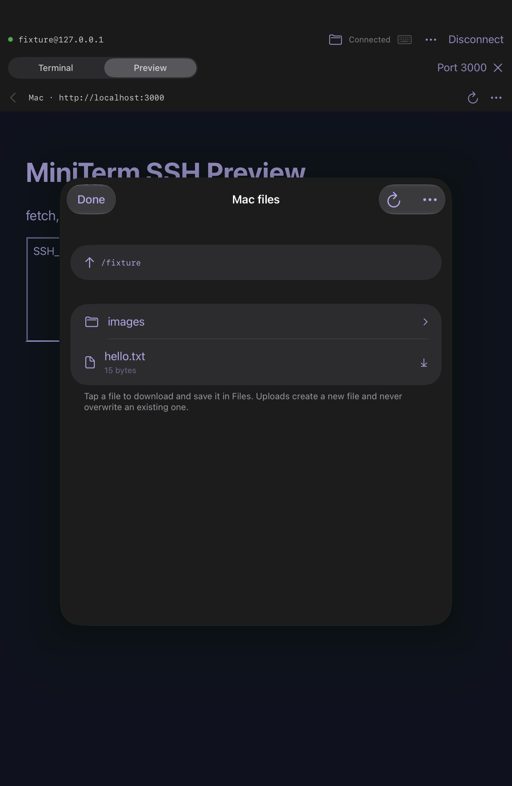

# Files on your Mac

Connect normally, then tap the terminal's **folder** button. The file browser uses the SFTP subsystem on that same authenticated SSH connection; it does not start another login or send commands through the terminal.

- Tap a folder to open it. The up arrow opens its parent. Tap the displayed path to enter another remote folder. Relative paths are resolved by the SFTP server, usually from your Mac home folder; use an absolute path for a specific location.
- Tap a regular file to download it, then choose a destination using the native Files export picker. Download staging files are removed when the picker/file browser closes. Cancelling a download removes its partial local copy.
- Choose **… → Upload from Files**, pick one file and enter a new filename on the Mac. The server must create a new file; existing files are never overwritten. Uploads are created with owner-only permissions (0600).
- **… → Show hidden files** reveals dotfiles. Symbolic links are resolved by the server; links to directories can be browsed and links to regular files downloaded. Device files, sockets and FIFOs cannot be downloaded.
- Refresh reloads the current folder. Only one browser operation runs at a time. **Cancel operation** closes the SFTP subsystem, leaving SSH/terminal/preview open. The next operation opens a fresh subsystem.

The browser uses your SSH account's existing permissions. If SFTP is disabled or restricted by the server, the terminal can still work while file browsing fails. Server-side restrictions and OS protected-folder permissions still apply.

## Transfer lifetime and limits

Transfers stream in 32 KiB blocks; files aren't loaded into memory as a whole. Directory results are limited to 10,000 entries and 1,000 response pages, individual protocol packets to 1 MiB, outstanding requests to 16, and response time to 15 seconds. Long or interrupted operations may need a retry.

A cancelled/failed upload can leave a **partial new file on the Mac**. MiniTerm does not delete remote files automatically. Choose another filename or remove the partial file yourself before retrying. Disconnecting cancels transfers. Reconnect never resumes or replays them. Keep MiniTerm foregrounded for transfers; iPadOS suspension can interrupt networking.

This version handles individual regular files. Folder uploads/downloads, remote deletion, rename/editing, overwrite and resume are not implemented. A file that changes size during download is rejected instead of being presented as complete. A same-size modification during transfer cannot be detected without a remote checksum protocol.

Paths, filenames and file bytes are not added to connection history/iCloud sync or diagnostic reports. Files you explicitly export or upload go to the locations you choose.

## Validation

`swift test` exercises the codec, malformed responses, request bounds/timeouts, and real encrypted SFTP operations against macOS's `/usr/libexec/sftp-server` with generated test identities and temporary files. The macOS-only integration checks include listing/stat, binary round trips, symbolic-link canonicalization, owner-only/exclusive creation, preserved existing destinations, independent PTY flow control and subsystem rejection/disconnect.

`python3 Scripts/test_workspace_features.py SIMULATOR_UDID` exercises app models and UI with generated SSH/HTTP/SFTP fixtures: saved previews, upload/list/download/export staging, explicit overwrite refusal, retained terminal/preview sessions, foreground/network recovery, cancellation of scheduled retries and fresh reconnect state. Native document-provider selection/export and actual physical-iPad sleep/Wi-Fi behavior still need device acceptance.
