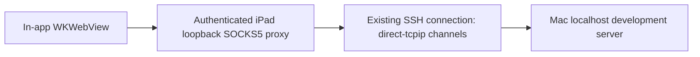

# Website previews over SSH

Status: first implementation added. See [usage and current limitations](PREVIEWS.md) and [validation](VALIDATION.md#website-preview-milestone). This document records the design and acceptance gates; not every gate is complete.

Physical-device revision: iPadOS 27.2 bypassed the proxy for localhost even with explicit match domains and failover disabled. The implementation now uses a reserved preview origin mapped to Mac localhost and blocks literal loopback page resources before loading. Physical fixture tests now cover routing, WebSocket/SSE, blocked loopback fetch/WebSocket, and failure after proxy shutdown. This changes Host/Origin/certificate expectations; see [current compatibility requirements](PREVIEWS.md). The localhost-origin proposal below records the original plan, not the current browser origin.

Implemented: authenticated embedded SOCKS5 preview, a separate experimental Safari forward, bounded relays on the existing SSH connection, retained workspace views, local port/protocol preferences, and fresh browser restoration after manual reconnect. The current reconnect reloads the root URL rather than restoring a path. Simulator checks cover page/assets/iframe, WebSocket/SSE, external HTTPS destination routing, navigation restrictions, no direct localhost fallback, and workspace lifecycle. Physical iPad/Safari, oldest-runtime coverage, real framework hot reload, speculative DNS behavior, full TLS scenarios, and unsupported browser protocols remain open. A small incremental CONNECT-only SOCKS parser avoids changing dependency pins.

## Goal and first version

Run a website development server on the Mac mini, leave it running in tmux, and view it inside MiniTerm on the iPad. Page requests, assets, and live reload should travel through the authenticated SSH connection. The Mac's development server can remain bound to loopback; publishing the website is unnecessary.

The user flow:

1. Connect to the Mac as usual and start the project's development server in the terminal.
2. Tap **Preview**, enter its port (initial default **3000**, editable for servers such as **5173**), and tap **Open**.
3. MiniTerm opens `http://localhost:PORT` in an embedded browser. Here, localhost must reach the **Mac**, through SSH.
4. Switch between **Terminal** and **Preview** without ending SSH or recreating the terminal. Preview provides back, reload, and a compact port/options control.
5. If SSH ends, show a disconnected state. The existing manual **Reconnect** action opens a fresh SSH connection; rebuild the preview route and offer to reload the page.

Use a full-width browser on iPad mini, with the existing restrained LCARS colors on app controls. Do not add decorative controls. Split view, multiple previews, automatic server discovery, automatic command execution, and Safari handoff are later work.

## Proposed transport

Give a dedicated `WKWebsiteDataStore` a SOCKS5 proxy configuration pointing at an app-owned listener on `127.0.0.1` and an OS-assigned port. The installed SDK declares both WebKit's proxy property and `Network.ProxyConfiguration` available from iOS 17, matching MiniTerm's minimum. **Availability does not prove routing behavior; milestone 1 must establish that on iPadOS.** See [WebKit proxy configurations](https://developer.apple.com/documentation/webkit/wkwebsitedatastore/proxyconfigurations-cdc1) and [Network proxy configuration](https://developer.apple.com/documentation/network/proxyconfiguration).

Each accepted browser TCP connection opens one `SSHChannelType.directTCPIP` child on the already authenticated NIOSSH parent. Pass requested destination hostnames to SSH so the Mac resolves them. Relay bytes with backpressure and half-close support. HTTP, HTTPS, WebSocket, secure WebSocket, and server-sent events should use this same path without rewriting HTML, JavaScript, Host headers, or live-reload URLs. NIOSSH documents this channel model in its [direct forwarding guidance](https://github.com/apple/swift-nio-ssh/blob/0.15.1/Sources/NIOSSH/Docs.docc/index.md).

Configure the proxy for all browser HTTP(S) destinations, including external scripts, fonts, and API dependencies, so these requests also originate from the Mac. Explicitly set `allowFailover = false`; a missing SSH route must produce an error instead of direct network access. Apple's [failover property](https://developer.apple.com/documentation/network/proxyconfiguration/allowfailover) controls fallback to an unproxied connection. Verify localhost bypass, DNS, and all supported resource types with traffic observations, not just a successfully rendered page.

Use SOCKS CONNECT only, with a fresh random credential per workspace, configured through `applyCredential`. Reject unauthenticated clients, BIND, and UDP association. Bind only to iPad loopback, never a LAN interface. Do not create another SSH login, a system proxy, a VPN, a Mac helper daemon, or a public HTTP listener.

The browser is for trusted development sites, not general browsing. Permit top-level navigation within the selected development origin; block unexpected external top-level navigation and external application schemes. External subresources may use the SSH proxy. A port change creates a new preview context. Unsupported protocols, including WebRTC/UDP and WebTransport, must be disabled or blocked where possible; if WebKit cannot enforce this, document that boundary and do not claim that arbitrary web content can only use SSH. This is a TCP web preview, not a device-wide tunnel.

## Integration with the current app

Reuse `SSHTransport`, NIOSSH, and the existing event loop. Keep Ghostty rendering and the terminal keyboard pipeline intact.

| Existing behavior | Required change |
| --- | --- |
| `TerminalScreen.onDisappear` disconnects SSH. | Introduce a workspace owner; disconnect only on workspace dismissal or explicit Disconnect. Keep the terminal mounted when showing Preview. |
| `setOutputPaused` pauses both the PTY and parent TCP channel. | Separate child flow control from aggregate transport pressure. A paused renderer must not indefinitely stall web traffic; a slow page must not accumulate unbounded data or starve typing. |
| Reconnect creates a fresh model, bridge, and transport. | Tie listeners and forwarded channels to that model's generation. Close old resources before attaching a new route; ignore stale completions. |
| Terminal child closure ends the SSH connection. | Preserve that behavior for V1. A forwarded connection's EOF/error closes only its paired streams; it must not end the terminal or other requests. |
| Input state is owned by the terminal adapter. | When switching focus, release held keys/modifiers through the existing cleanup path and resign terminal first responder. Restore focus deliberately on return. |

Proposed responsibilities, with final filenames chosen during implementation:

- **Core forwarding:** an authenticated-parent child-channel API, paired stream relay, cancellation, deadlines, and resource limits.
- **Core loopback proxy:** bounded SOCKS negotiation and destination validation, per-workspace authentication, listener lifecycle, and isolated connection errors.
- **App preview model:** selected port, current URL in memory, preview state, transport generation, safe errors, and WebKit context ownership.
- **App workspace and web view:** Terminal/Preview selection, shared connection controls, navigation policy, and WebKit delegate handling.

All transport mutations stay on the existing NIO event loop; observable UI state stays on the main actor. Establish explicit per-stream and aggregate byte limits, a concurrent stream cap, and handshake/channel-open timeouts before implementation. Normal WebSocket/SSE idle periods must not be treated as stalled handshakes. Verify NIOSSH's actual buffering and channel-window behavior under the pinned version before choosing limits.

The project pins NIO **2.81.0** and NIOSSH **0.15.1**. Review a compatible `NIOSOCKS` release for server negotiation and credential support before adding a dependency. Do not upgrade the transport stack just to take the latest codec. If no suitable codec fits, a small CONNECT-only implementation requires dedicated malformed-input and fragmentation tests.

## State, storage, and errors

Preview states: **closed → starting → loading → ready**, with **failed** for a request/proxy problem and **disconnected** when SSH ends. WebSocket connections can remain active while the terminal is visible. Closing Preview closes its listener and forwarded streams while leaving SSH connected. Returning to the connection form closes everything.

On connection loss, stop navigation and close the listener and streams. Retain the selected port and last allowed URL in memory. On manual reconnect, create a new route and browser context; reload only against the new authenticated connection. Browser login state may reset. Host verification remains part of the normal SSH connection process.

Use a nonpersistent WebKit data store isolated to this workspace and development origin. Save only the last chosen port locally per connection profile. Do not add preview URLs, query strings, cookies, page contents, or proxy credentials to iCloud history or diagnostics. Extend the existing diagnostic allowlist with phase/error categories and bounded counts, without raw network errors or URLs.

Validate ports as integers from **1–65535** before constructing an SSH request. Distinguish invalid port, server not running, forwarding denied, SSH disconnected, and page/TLS failure. The terminal stays usable after preview-only failures. OpenSSH can restrict forwarding through `AllowTcpForwarding`, `DisableForwarding`, `PermitOpen`, or key restrictions; explain a denial without changing Mac settings automatically. See [sshd_config](https://man.openbsd.org/sshd_config).

Keep standard HTTPS certificate validation. Add only the narrow ATS configuration needed for the selected local HTTP origin, and verify the effective configuration on device; do not enable arbitrary insecure web loads. See [Apple local networking configuration](https://developer.apple.com/documentation/bundleresources/information-property-list/nsapptransportsecurity/nsallowslocalnetworking). Keep the preview inside MiniTerm because iPadOS can suspend the SSH app when another app becomes foreground; no background continuity guarantee. See [Apple's background lifecycle](https://developer.apple.com/documentation/uikit/about-the-background-execution-sequence).

## Milestones and acceptance gates

### 1. Prove the iPadOS networking path

Build a small disposable test using the actual minimum supported API surface and an authenticated SSH route before committing to the full UI.

- Test proxy credentials, localhost/IPv4/IPv6 routing, hostname resolution on the Mac, HTTP, HTTPS, redirects, assets, fetch, iframes, WebSocket, and SSE.
- Test a Mac server bound only to loopback. Ensure the iPad cannot reach that server directly; observe proxy/SSH connections to prove the route.
- Load a page with an external dependency, then break SSH while the iPad still has internet access. Confirm no direct fallback or local DNS leakage for supported requests.
- Establish behavior for unsupported browser protocols and HTTPS validation. Check ATS behavior on the oldest supported runtime available and current physical iPadOS; record unavailable runtime coverage explicitly.
- Resolve the SOCKS codec/dependency choice without changing the existing NIO pins unnecessarily.

**Gate:** if WebKit bypasses the proxy for required traffic or cannot prevent direct fallback, stop and revise the transport design. Do not silently ship a LAN preview or claim SSH-only behavior. A different preview origin or forwarding approach must pass the same tests before proceeding.

### 2. Add tested forwarding to MiniTermCore

- Test authenticated channel creation, refused/denied destinations, authentication failure, malformed/fragmented SOCKS messages, port boundaries, and cancellation during channel opening.
- Test real encrypted loopback SSH with concurrent HTTP connections, binary WebSocket traffic, SSE, large responses, half-closes, and abrupt disconnects.
- Verify one request failure does not close sibling streams or the terminal. Verify bounded buffering, stream caps, and fair progress while terminal output is paused and while a download is active.
- Test repeated open/close, generation changes, and teardown with no listener, task, or channel leaks.

**Gate:** transport tests pass under the existing pins, with explicit resource limits and terminal backpressure regressions covered.

### 3. Integrate the minimal workspace UI

- Add Preview, port entry, Terminal/Preview selection, back/reload, and clear retry states. Keep the terminal instance alive across switching.
- Implement navigation restrictions, isolated nonpersistent browser state, local port preference, and safe diagnostic categories.
- Verify keyboard focus and held-modifier cleanup, reconnect to the same tmux session, restored preview selection, and stale-callback rejection.

**Gate:** simulator builds and lifecycle probes pass; repeated switching never disconnects SSH or sends browser typing to the terminal.

### 4. Verify real development workflows on iPad mini

- Test a static site and representative installed Vite/Next.js projects: page navigation, relative assets, cookies, API calls, redirects, and hot reload after a Mac-side edit.
- Keep standard host/origin checks enabled. If framework-specific configuration is necessary, document it for the tested version; do not disable host checks or broadly enable CORS. Consult the current [Vite server options](https://vite.dev/config/server-options) when testing its live-reload transport.
- Test portrait/landscape, software and hardware keyboards, browser form entry, terminal typing during downloads, Wi-Fi interruption, reconnect, background/foreground, and server restart.
- Repeat the no-direct-fallback test on the physical iPad. Record OS/framework versions and what was actually observed.

**Done:** a Mac loopback-only server is usable on the iPad through SSH, including tested assets and live reload; terminal/preview switching preserves SSH; loss of SSH stops supported preview traffic without a direct route; manual reconnect restores a working preview; resource limits and teardown are tested. Update the README with actual setup instructions, screenshots, and measured limitations only after these gates pass.
